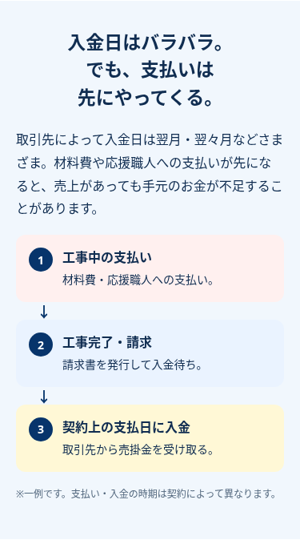

# 戦略チーム向け：LP試作レビュー

2026-10-16。ブランチ feat/lp-brief-20261016。本番サイトとは別の試作です。利用者承認によりコード・画像を共有します。mainマージ・本番公開・広告出稿は行いません。

## 最新：SEO検証用・送客停止版

[2026-10-18のSEO基本設定・再テスト・レビュー判定](seo-release-review-20261018.md) ／ [最新375px](evidence/seo-release-20261018/after-full-375.png)。A8送客やGoogle広告は開始せず、mainマージ・公開は最終承認後です。

## 前回の最終レビュー

[PR #8](https://github.com/going-ux/shikin-lp/pull/8) はDraftです。[マージ状態・再テスト・A8送客版公開までの残課題](pr8-final-review-20261017.md)を確認してください。

## 公開準備の変更

[公開準備の変更・テスト・A8確認事項・PR作成状況](release-review-20261017.md) ／ [最新375pxの全体](evidence/release-prep-20261017/after-full-375.png)。送客停止中、main未反映です。

## これまでの試作画像

[最新の変更後ページ全体（375px）](evidence/cycle-copy-20261017/after-full-375.png) ／ [今回の変更前（375px）](evidence/cycle-copy-20261017/before-full-375.png) ／ [見出し・説明の変更と検証](cycle-copy-review-20261017.md)

### 入金サイクル図

### QuQuMo紹介

## 変更とレビュー依頼

固定コピー、青白黄、黄色CTAを維持。図解は縦3段とし、契約による時期差を明記。QuQuMo単社紹介で、他社データと比較機能は削除せず非表示。試作の外部送客は停止しています。

1. 図解は分かりやすいか。増えたスクロール量は許容できるか。
2. 単社紹介・CTAの表現に誤認はないか。
3. 公開前の条件確認や説明に不足はないか。

320/375/390pxのChromium、FAQ、キーボード、固定CTA、計測キュー、旧比較機能の互換テスト成功。GA4実受信・A8帰属・最新公開条件・掲載/広告経路の許可・実機・CVR/利益は未確認。クリックを申込や承認成果とは扱いません。

[全幅の画像・変更ファイル・イベント仕様・テスト・未確認事項](implementation-review-20261016.md) ／ [コード差分](evidence/implementation-20261016/changes.patch) ／ [検証結果JSON](evidence/implementation-20261016/results.json)

内部の戦略資料、会員向け報酬・EPC・確定率、非公開条件は同梱しません。GitHubでHTMLソースを開いても動作プレビューにはなりません。画像を開いてレビューしてください。
